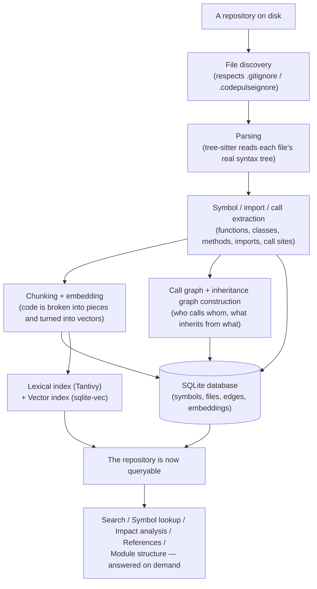
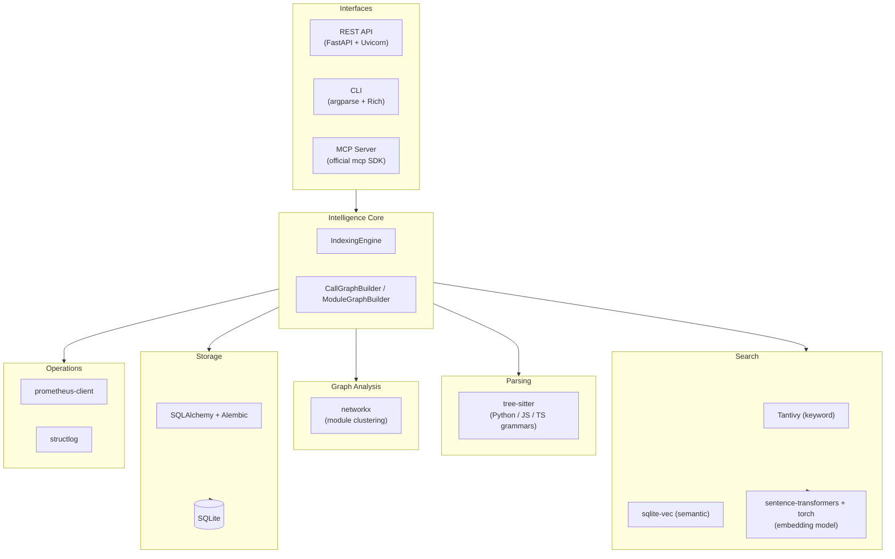
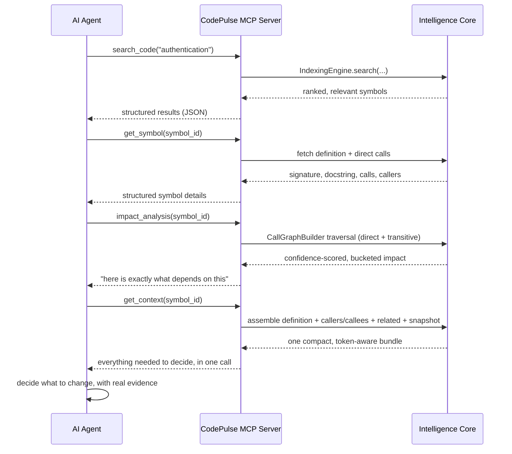

# CodePulse — Product & Technical Explanation

*Written against verified checkpoint `6dc2fe2`. Source of truth: the actual code, tests, and migrations in this repository for "what exists today"; `CodePulse_Strategy_and_Roadmap.md` for "what the product is meant to become." Where the two disagree, this document says so explicitly rather than picking one.*

---

## Part 1 — What CodePulse Actually Is

### The problem

Every developer has had this experience: you open a codebase you didn't write — or wrote six months ago and forgot — and you need to change one function. Before you can safely touch it, you need to answer questions like:

- What does this function actually do?
- What does it call?
- Who calls it?
- If I change its behavior, what else in the codebase might break?
- Is there similar code elsewhere that does the same thing?
- How does this file fit into the rest of the system?

A large repository can have tens of thousands of functions spread across thousands of files. Answering those questions by reading code top-to-bottom doesn't scale. `grep` finds text, not meaning — it can find every line containing the word `charge`, but it can't tell you that `process_payment()` calls `charge_card()` which is also called from three other places you haven't thought to search for. And a large-language-model chat window has no memory of your repository's actual structure at all — it can only reason about whatever text you happen to paste into it.

This is the gap CodePulse exists to close.

### What CodePulse is

CodePulse is a **local-first, agent-native code intelligence engine**. In plain terms: it's a program that reads a codebase, builds a structured, queryable understanding of it, and then answers precise questions about that codebase — for a human developer working in a terminal, or for an AI coding agent that needs real facts about the code it's about to modify, not just a fuzzy text match.

"Local-first" means it runs entirely on your own machine against your own files, using an embedded database and embedded search indexes — no cloud service, no separate infrastructure to stand up, no code leaving your computer to answer a query. "Agent-native" means its answers are already structured (JSON, not prose) and deliberately shaped to be cheap and unambiguous for an automated agent to consume, not just readable by a person.

### What makes it different from a normal code search tool

A normal code search tool (including `grep`, or a basic "search this repo" box) answers one kind of question: *"where does this text appear?"* CodePulse answers three different kinds of questions, and — this is the important part — it keeps them **separate rather than blurring them together**:

1. **"Where is code that is *about* this?"** — relevance-based search. You might be looking for "authentication," and the exact string "authentication" might not appear anywhere near the actual login-checking code.
2. **"How is this piece of code *structurally connected* to the rest of the codebase?"** — who calls it, what it calls, what inherits from it, what file imports what.
3. **"If I change this, what is actually at risk?"** — a deliberately bucketed, confidence-scored answer, not a guess.

A plain search tool only really does (1), and does it by text-matching alone. CodePulse does (1) using more than text-matching (see Part 5), and separately builds and exposes (2) and (3) as **real, navigable structure** — not by asking a language model to "explain the code," but by actually parsing it into a graph.

### What CodePulse knows deterministically — without ever calling an LLM

This is a deliberate, load-bearing design decision, not an accident: **every piece of code structure CodePulse produces — symbols, imports, function calls, class inheritance, module clusters, search rankings, impact analysis — is computed by ordinary, deterministic program logic (an AST parser, a graph algorithm, a ranking formula).** None of it is generated or guessed by a language model. Running the exact same query against the exact same unchanged snapshot of a repository always produces the exact same answer.

The *only* place anything resembling "AI" appears today is the **embedding model** used for semantic search (Part 5) — and even that isn't a chat model generating text; it's a small model that converts a piece of code into a list of numbers, purely to let CodePulse compare "does this code mean something similar to that code," which is itself then fed into an otherwise fully deterministic ranking pipeline.

Nothing in the current implementation calls out to a large language model at any point. (The roadmap explicitly reserves a *future*, strictly additive role for one — see Part 13 — but it does not exist in the code today, and CodePulse's own core design invariant is that nothing downstream should ever *require* an LLM to function.)

### A concrete example: changing a function

Suppose a developer needs to change `hash_password()` somewhere in a real codebase CodePulse has indexed. Here's the path CodePulse actually supports, end to end, using only capabilities that exist in the code today:

```
1. Find it:            search "password hashing" → CodePulse returns hash_password,
                        even if that exact phrase never appears in the code, because
                        semantic search matches meaning, not just text.

2. Understand it:      "Show me the symbol" → its signature, docstring, and body.

3. Find what it calls:  "What does hash_password call?" → its downstream dependencies,
                        each one tagged with how confident CodePulse is about that
                        connection (Part 6).

4. Find what calls it: "What calls hash_password?" → every direct and transitive
                        caller — the actual blast radius of changing it.

5. Find related code:  "What else looks like this?" → semantically similar functions
                        elsewhere in the repo (maybe a second, redundant hashing
                        helper nobody remembered existed).

6. Understand impact:  A single call returns ALL of the above, already organized
                        into "direct" vs "transitive" effects, with a note if the
                        answer had to be shortened for length.

7. Hand it to an agent: The exact same structured answer — not a re-explained,
                        re-summarized version of it — is what an AI coding agent
                        would receive if it asked the same question through
                        CodePulse's agent interface (Part 11).
```

Every one of those seven steps corresponds to a real, working capability described later in this document (Parts 5, 6, and 11) — this is not an aspirational example.

---

## Part 2 — The Core Idea, In One Simple Model

CodePulse's own internal design document states its core loop this way:

```
Index → Retrieve → Explain (structure) → Navigate → Decide (impact) → Act
```

In plain English, one stage at a time:

- **Index** — *"Read the repository once, and remember it."* CodePulse walks the files, parses each one, and stores what it learns (symbols, imports, calls) so it never has to re-read the whole repository from scratch just to answer one question.
- **Retrieve** — *"Find the code that's relevant to what I'm asking about."* This is search — by keyword, by meaning, or both at once (Part 5).
- **Explain (structure)** — *"Tell me what this piece of code actually is and how it's built."* A symbol's signature, its docstring, its type (function, class, method), what file it lives in.
- **Navigate** — *"Let me move from this piece of code to the things connected to it."* Callers, callees, direct references, subclasses (Part 6).
- **Decide (impact)** — *"Help me reason about the consequences of a change before I make it."* Direct-vs-transitive impact bucketing, confidence-scored, so "this might break" and "this will almost certainly break" are never presented as the same thing.
- **Act** — *"Now hand a clean, structured answer to whoever asked — a developer, or an automated agent — so they can actually do something with it."* This is the REST/CLI/MCP layer (Part 10) returning the final answer.

Every later part of this document is really just a deeper look at one of these six stages.

---

## Part 3 — The Story of What Happens Inside CodePulse

This section follows a repository from the moment CodePulse is pointed at it to the moment it can answer a question about it.



**1. A repository shows up.** A developer runs `codepulse index <path>` (or points the REST API / an MCP client at it). CodePulse is told a directory to look at.

**2. File discovery.** Before reading anything, CodePulse figures out which files actually matter — it respects `.gitignore` and a CodePulse-specific `.codepulseignore` file, so it never wastes time (or leaks secrets) by indexing generated files, dependency folders, or anything else the project itself says to ignore.

**3. Parsing.** For each remaining source file, CodePulse doesn't treat the code as plain text — it uses **tree-sitter**, a real parser, to build the file's actual *syntax tree* (the same kind of structure a compiler builds). This is what makes everything after this step reliable: CodePulse isn't guessing where a function starts based on indentation, it *knows*, because it parsed the grammar. Today this works for **Python, JavaScript, and TypeScript**.

**4. Understanding code structure.** From that syntax tree, CodePulse pulls out the things that actually matter for intelligence later: every function/method/class (a **symbol**), every `import` statement, every place one piece of code calls another, and — for classes — what base class(es) they declare. This is covered in depth in Part 4.

**5. Turning code into something searchable by meaning.** In parallel, the body of each symbol is broken into reasonably sized pieces ("chunks") and converted into a numeric vector by an embedding model — this is what later makes *semantic* search possible (Part 5).

**6. Building relationships.** Every extracted call and every extracted base-class name gets *resolved* — CodePulse tries to figure out exactly which other symbol a call or a base class actually refers to, and how confident it is about that resolution (Part 6). This produces the call graph and the (separate) inheritance graph.

**7. Storing everything durably.** Symbols, files, resolved relationships, and the embedding vectors are written to a local SQLite database (`codepulse.db` by default) — so the next time CodePulse starts up, it doesn't have to redo any of this work from scratch for unchanged code (Part 7).

**8. Building the search indexes.** The extracted text and the embedding vectors are loaded into two specialized, embedded search engines — one built for fast keyword search (Tantivy), one built for fast "find similar meaning" search (sqlite-vec) (Part 5).

**9. The repository is now queryable.** At this point, a developer, the CLI, the REST API, or an AI agent through MCP can ask CodePulse anything covered in Parts 5, 6, and 11 — and every answer comes back as structured data, computed from the graph and indexes that were just built, not re-derived from scratch each time.

---

## Part 4 — How CodePulse Understands Code

CodePulse builds what is best thought of as a **map of the repository**. The map has a small number of concepts, and understanding them is really understanding everything CodePulse can do.

| Concept | What it means | A concrete example |
|---|---|---|
| **File** | One source file, tracked by its path and a hash of its content (so CodePulse can tell if it changed) | `app/auth.py` |
| **Symbol** | One named, definable "thing" in the code — a function, a method, or a class | `def hash_password(pw): ...` |
| **Import** | A statement connecting one file to code defined in another | `from app.utils import hash_password` |
| **Call** | One symbol invoking another | `hash_password()` being called inside `register_user()` |
| **Base class / inheritance** | A class declaring another class as its parent | `class AdminUser(User): ...` |
| **Module** | A cluster of files that tend to depend on each other, discovered automatically (not manually labeled) | "the parsing files all import each other far more than they import the API files" |

### Why this matters: relationships become the raw material for everything else

Once CodePulse knows *File A imports File B*, *Function X calls Function Y*, and *Class Child inherits from Class Parent*, it can answer questions no keyword search ever could:

- *"What actually happens when `caller()` runs?"* → follow the call edges outward.
- *"What would break if I deleted `helper()`?"* → follow the call edges backward.
- *"Is `Dog` a specialization of `Animal`?"* → follow the inheritance edge.
- *"What files form a natural group in this codebase?"* → look at which files import each other most densely.

None of these questions can be answered by treating source code as plain text. They require the structured map described above — which is exactly what "Explain (structure)" and "Navigate" in Part 2's core loop refer to.

### A deliberate design decision: three separate relationship "graphs," not one giant graph

CodePulse tracks **calls**, **inheritance**, and **imports** as three genuinely separate structures internally, even though a subclass, a caller, and an importer can all technically be described as "something connected to this symbol." This is intentional, not an oversight — see Part 6 for why blending them would produce misleading answers (a subclass is not "calling" its base class, and conflating the two would make impact analysis lie about what's actually at risk).

---

## Part 5 — How CodePulse Finds Relevant Code

Imagine asking CodePulse to find code related to **authentication**. There is more than one way it can look, and it's worth understanding each one in plain language before seeing how they combine.

### Keyword search — "find the words"

The simplest kind of search just looks for matching words, but does it *well*: it knows that "authentication," "authenticate," and "auth" are related word forms, and it ranks results by how significant a matching word is to a given piece of code (a word that appears in almost every file, like `def`, tells you nothing; a rare word appearing in exactly one function tells you a lot). This scoring approach is a well-established algorithm called **BM25**. CodePulse's keyword search is powered by **Tantivy**, an embedded, high-performance text-search engine (similar in spirit to Elasticsearch, but running entirely inside CodePulse's own process — no separate server).

### Semantic search — "find the meaning"

Keyword search has an obvious blind spot: if the actual authentication code is named `verify_credentials()` and never contains the word "auth" anywhere, keyword search will miss it. Semantic search solves this by converting *both* the query and every piece of indexed code into an **embedding** — a list of a few hundred numbers that represents the *meaning* of that text, produced by a small, specialized machine-learning model (not a chat model — it never generates text, it only measures similarity). Two pieces of text with similar meaning end up with numerically similar embeddings, even if they don't share a single word. CodePulse stores these embedding vectors in **sqlite-vec**, an embedded vector-search extension for SQLite, and finds the closest matches by comparing vectors mathematically.

*(Technical note, disclosed honestly rather than glossed over: the roadmap originally hoped for an **approximate** vector search structure — the kind large-scale systems use to stay fast at massive size, often called ANN, "approximate nearest neighbor." The library actually used, `sqlite-vec`, currently performs an **exact** search instead. This was a deliberate, disclosed trade-off — see Part 13 — not a bug, and it has the nice side effect of making results perfectly deterministic.)*

### Combining both signals

Keyword and semantic search each catch things the other misses, so CodePulse combines their scores rather than picking one. It supports two combination strategies:

- **Weighted fusion** — each signal (keyword relevance, semantic relevance, and a third signal based on how "central" a symbol is in the call graph — see below) contributes a tunable percentage to a single final score.
- **RRF (Reciprocal Rank Fusion)** — a different, rank-based way of combining multiple ranked lists into one, without needing the different signals' raw scores to be on comparable scales.

### A third signal: graph centrality

CodePulse also folds in a small signal from the call graph itself: a symbol that is called from many places in the codebase is, all else being equal, more likely to be the thing you're actually looking for than an obscure, rarely-used helper with a similar name. This is a real, if modest, way that Part 6's relationship graph feeds back into Part 5's search.

### Why all this matters

A developer (or an agent) rarely knows the *exact* name of the code they're looking for. Combining "matches these words" with "means something similar to this" with "is actually important in this codebase's own structure" produces a search experience that survives the gap between how a person describes a problem and how a codebase happens to be written.

---

## Part 6 — The Graph / Relationship Side

Searching finds code. It does not tell you how that code is *connected* to everything else. That's a fundamentally different question, and CodePulse answers it with a genuine graph, not a re-run of search.

### A simple example

Suppose:

```
A() calls B()
B() calls C()
```

If a developer is about to change `B()`, two different questions matter:

- **"What does B depend on?"** (its *callees*) — here, `C()`. If `C()`'s behavior is unreliable, `B()` inherits that risk.
- **"What depends on B?"** (its *callers*) — here, `A()`, and transitively, anything that calls `A()`. This is `B()`'s actual *blast radius*: everything that could be affected if `B()`'s behavior changes.

CodePulse answers both, and — importantly — it distinguishes **direct** effects (one hop away, e.g. `A()` calling `B()` directly) from **transitive** effects (two or more hops away), rather than lumping "will definitely be affected" together with "might eventually be affected three calls downstream." This direct-vs-transitive split, together with a confidence rating on every single connection (see below), is what makes CodePulse's impact answers something a developer can actually trust rather than a vague "here's everything that might be related."

### Confidence — because not every connection is equally certain

When CodePulse sees code call something named `helper()`, it doesn't always know for certain *which* `helper()` — there could be several in a large codebase. So every single connection it reports carries one of three honest confidence levels:

- **High** — resolved through an explicit `import` to a specific, verified symbol. Very likely correct.
- **Low** — resolved only by matching a bare name within the same file. Plausible, but genuinely ambiguous if two unrelated things share a name.
- **Unresolved** — CodePulse could not match the call to any known symbol at all (it might be calling into a third-party library, or a symbol CodePulse's parser genuinely can't see).

This matters because a tool that silently treats all three the same way would eventually mislead someone into thinking a change is safe (or unsafe) when it genuinely doesn't know. CodePulse never collapses this into a single fabricated "yes/no" answer.

### Beyond calls: references and inheritance

Two more relationship types exist, deliberately kept **separate** from the call graph:

- **References** — "what directly points at this symbol" — both ordinary callers *and*, for a class, its direct subclasses. This answers the plain "find references" question a developer expects from any IDE.
- **Inheritance** — CodePulse extracts and resolves `class Dog(Animal):`-style relationships (Python and JavaScript/TypeScript), using the exact same confidence vocabulary described above, so "Dog is a subclass of Animal" carries the same honesty guarantee that a function call does.

### Why not one giant graph?

It would be technically possible to merge calls, inheritance, and references into a single, undifferentiated "everything connects to everything" graph. CodePulse deliberately does not do this, for a concrete reason: **a subclass is not "calling" its base class.** If impact analysis (which answers "what breaks if I change this function's behavior") accidentally counted every subclass as a "caller," it would systematically overstate risk for every class in the codebase and understate the genuinely distinct question of "who actually invokes this code path." Keeping the graphs separate is what lets each question get an honest, uninflated answer.

### Module clustering — the whole-repository view

Beyond the symbol-level call/inheritance graphs, CodePulse can also look at the **file-level import graph** for an entire repository and automatically detect clusters of files that depend heavily on each other — a deterministic, no-LLM way of answering "what are this codebase's actual modules?" without anyone having to label them by hand. (Practically, this is currently a capability that exists in CodePulse's underlying engine but is not yet exposed through the REST API, CLI, or MCP — see Part 13 for the precise current status.)

---

## Part 7 — Incremental Intelligence: Keeping Up With Change

A codebase is never static. If CodePulse had to re-read, re-parse, and re-embed an entire 10,000-file repository every time a single file changed, it would be far too slow to use day-to-day. So it doesn't.

### What CodePulse actually does on a re-index

When `codepulse update <path>` (or an equivalent call) runs against a repository CodePulse has seen before, it:

1. **Asks Git what changed** since the last time it indexed this repository — which files were added, modified, deleted, or renamed. This is real `git diff`-based change detection, not a full re-scan.
2. **Skips everything unchanged.** A file that didn't change at all costs nothing.
3. **For a changed file, skips symbols that didn't actually change**, even within that file — CodePulse compares a hash of each individual function/class body, not just the whole file, so editing one function doesn't force every other function in that same file to be needlessly re-processed.
4. **Follows renames, not just deletions.** If Git reports a rename (not a delete-and-recreate), CodePulse re-keys the existing symbol/embedding history under its new path instead of throwing it away and starting over.
5. **Surgically updates the call graph**, rather than rebuilding it whole. Only the edges genuinely touched by what changed are recomputed — including a "one hop out" correction so that an *unrelated, unchanged* file whose function called something that just disappeared or got renamed still gets its own record corrected.

### A concrete example

Suppose a developer renames `payment_service.py` to `billing_service.py`, without changing any code inside it.

- CodePulse's rename detection recognizes this as a rename, not a delete-plus-new-file, and carries the file's existing symbols and their embedding history forward under the new name — no wasted re-embedding work for code that didn't actually change.
- Any *other*, unrelated file that calls a function defined in that file still has its own call-graph record correctly pointing at the renamed file afterward — even though that other file was never touched and never re-parsed.

### Why this matters in the real world

Without this, using CodePulse on a large, actively-developed repository would mean either accepting a multi-minute wait after every single commit, or letting the index silently go stale. Incremental intelligence is what makes "index once, then keep it accurate forever with near-zero ongoing cost" an actual, working property of the system rather than an aspiration.

### Restart behavior — an honestly disclosed limit

Some of CodePulse's fastest structures — the in-memory call graph, the lexical search index, the vector search index — currently live only in the running process's memory and do **not** persist to disk between restarts. Restarting CodePulse and asking a graph-based question about a repository it hasn't yet re-indexed *this process* will trigger a fresh (though still efficient) full rebuild, rather than resuming instantly. The durable data (symbols, files, resolved relationships, embedding vectors) always survives a restart in the SQLite database; it's the *derived, in-memory-only* structures built on top of that data which currently have to be recomputed after every process restart. This is a real, currently-open item, not something to assume is already solved.

---

## Part 8 — The Technology Stack, Layer by Layer

Every technology below was confirmed directly in `pyproject.toml` and the actual source code — nothing here is assumed from the tool's category alone.



### Language / Runtime
**Python 3.11+.** The entire intelligence core, all three interfaces, and every parser adapter are Python. No other backend runtime is involved.

### API / Server
**FastAPI** (the web framework) with **Uvicorn** (the actual server process that runs it) and **Pydantic** (which validates every request/response shape). This is what powers the REST API and its `/health`/`/metrics` endpoints.

### Parsing
**tree-sitter**, via the `tree-sitter-languages` package, which bundles ready-to-use grammars. This is what turns raw source text into a real syntax tree for Python, JavaScript, and TypeScript — the foundation everything in Part 4 depends on.

### Storage
**SQLAlchemy** (the Python layer that talks to the database) plus **Alembic** (which manages schema changes over time as real, reviewable migration files) on top of **SQLite** — a single-file, embedded, zero-configuration database. This combination is what makes "local-first, no infrastructure to install" actually true: the entire durable state of CodePulse is one file on disk.

### Search
**Tantivy** for keyword search (a Rust-based, embedded search-engine library with Python bindings) and **sqlite-vec** for vector/semantic search (a SQLite extension purpose-built for storing and searching embedding vectors). Both run *inside* CodePulse's own process — no separate search server to run or maintain.

### Embeddings / AI
**sentence-transformers**, running on **torch** (PyTorch), is the model that actually produces the numeric embedding vectors described in Part 5. This is the one place in the stack that could be called "machine learning" in the traditional sense — and, as covered in Part 1, it is used purely as a similarity-measurement tool, not a text-generation one.

### Graph Analysis
**networkx**, a general-purpose graph-algorithms library, powers the module-clustering capability described in Part 6 (specifically, a community-detection algorithm called Louvain). The symbol-level call graph and inheritance graph, by contrast, are built with CodePulse's own hand-written graph logic — not networkx — because their exact confidence/repository-isolation rules are specific enough to this project that a general-purpose library wasn't the right fit there.

### Agent Interface
The official **`mcp`** Python SDK (Model Context Protocol) powers CodePulse's MCP server — the interface an AI coding agent (such as one running inside an editor or a chat client) can connect to directly, described fully in Part 11.

### Developer Interface
Python's built-in **argparse** for command parsing, and **Rich** for readable, colorized terminal output — this is what powers the CLI (`codepulse search`, `codepulse impact`, etc.).

### Operations
**prometheus-client** (real, standard operational metrics — request counts, latency histograms, job counts) and **structlog** (structured, machine-parseable JSON log lines). Both existed only as unused, declared dependencies for a long stretch of this project's history; they are now genuinely wired into real code paths.

### How it all fits together

Every layer above exists to serve exactly one thing: the **Intelligence Core** (`IndexingEngine` plus its graph-builder components) — which is the *only* place that actually understands a codebase. Every interface (REST, CLI, MCP) is a thin adapter that translates a request into a call against that same core and translates the answer back into whatever shape that interface's callers expect. No interface ever re-implements graph logic, search logic, or ranking logic on its own — see Part 10 for why this matters.

---

## Part 9 — What CodePulse Remembers (The Data Layer)

CodePulse needs to remember several genuinely different kinds of things, and it's worth separating *what's actually saved to disk* from *what's recomputed on demand* from *what only ever lives in memory* — because they have very different durability and performance properties.

### What is durably persisted (survives every restart)

All of this lives in the single SQLite database file:

| What | Why it needs to be remembered |
|---|---|
| **Repositories** | Which codebases CodePulse has indexed, and basic stats about each |
| **Files** | Every source file's path, language, and a content hash (to detect changes) |
| **Symbols** | Every function/class/method: name, signature, docstring, body, location, complexity, and (for classes) raw base-class names |
| **Call / inheritance edges** | Every resolved relationship between symbols, each with its confidence tier and whether it's a "calls" or "inherits" relationship |
| **Embeddings** | The actual numeric vectors produced for each code chunk, so semantic search survives a restart without re-running the embedding model over the whole repository again |
| **API keys & repository grants** | Who is allowed to access which repository, and at what permission level (Part 10) |
| **Index jobs** | The real, pollable status of an in-progress or completed indexing run |
| **Repository snapshots** | The exact Git commit a repository was at the last time it was successfully indexed — this is what makes incremental re-indexing (Part 7) possible |

### What is calculated on demand, from that durable data

The call graph, the inheritance graph, the module-cluster graph, and every impact-analysis/reference answer are **computed fresh, in memory, from the durable data above, every time they're needed** — they are not separately stored. This is a deliberate simplicity choice: it avoids ever having a second, potentially-stale copy of "what the graph looks like" drifting out of sync with the real, underlying symbols and edges.

### What lives only in memory (does not survive a restart)

The lexical search index (Tantivy) and the vector search index (sqlite-vec) are currently built up **in memory** each time CodePulse starts and indexes/hydrates a repository — they do not yet persist their own on-disk index segments between restarts (already disclosed in Part 7). The in-memory cache of parsed file contents (used to make incremental re-indexing efficient without re-reading unchanged files from disk) is similarly per-process.

---

## Part 10 — The Three Ways of Using CodePulse Today

CodePulse exposes exactly the same intelligence through three different doors. This is the single most important architectural fact about the project, so it's worth stating precisely:

```mermaid
flowchart LR
    REST["REST API<br/>(POST /v1/search, /v1/symbols/&#123;id&#125;, /v1/agent/context, ...)"]
    CLI["CLI<br/>(codepulse search / impact / refs / ...)"]
    MCP["MCP Server<br/>(search_code, get_symbol, impact_analysis, ...)"]
    CORE["Shared Intelligence Core<br/>IndexingEngine + CallGraphBuilder + ModuleGraphBuilder"]

    REST --> CORE
    CLI --> CORE
    MCP --> CORE
```



**None of the three interfaces contains its own copy of any graph algorithm, ranking formula, or resolution logic.** Every one of them is a thin translation layer: parse the caller's request, call the exact same underlying engine method every other interface calls, translate the result into whatever shape that interface needs (an HTTP JSON response, a Rich-formatted terminal table, an MCP tool result). This was verified directly in the code, not assumed: the REST route for "find symbols similar to this one" and the MCP tool with the same purpose both call the identical `IndexingEngine.find_similar_symbols` function underneath.

### REST API — for services and integrations

**Who uses it:** any external program, script, or web client that wants to talk to CodePulse over HTTP.
**What it can do:** search, index a repository, look up a symbol, find similar code, run impact analysis, find references, fetch an agent-context bundle, check job/repository status, and standard operational endpoints (`/health/live`, `/health/ready`, `/metrics`).
**Access control:** every endpoint requires an API key except the health/metrics endpoints (which are meant to be reachable by monitoring infrastructure without credentials). Keys are scoped to specific repositories, and — as of this project's most recent work — each repository grant carries a **role** (`viewer`, `indexer`, or `admin`), so a key can be allowed to read a repository's data without also being allowed to trigger a fresh re-index of it.

### CLI — for a developer working in a terminal

**Who uses it:** an individual developer, right where they already work.
**What it can do:** everything the REST API can do for a single, locally-indexed repository, in a form suited to a terminal — readable tables and trees by default, or raw JSON output (`--json`) for scripting.
**How it reaches the core:** each command constructs the same `IndexingEngine` and calls the same methods the REST route for that capability calls.

### MCP Server — for an AI coding agent

**Who uses it:** an AI agent (running inside an editor, a chat client, or any other MCP-compatible tool) that needs to ask precise, structured questions about a codebase as part of deciding what code to write or change.
**What it can do:** search code, fetch a symbol, find its callers/callees, run impact analysis, find similar code, and fetch the full agent-context bundle — the same seven capabilities named explicitly in the project's own design document.
**How it's different from REST/CLI:** an MCP connection is authorized *once*, when it's first set up (scoped to one or more repositories), rather than on every single call — matching how MCP clients actually work in practice, and avoiding the need for an agent to attach credentials to every individual question it asks.

### Why the shared-core architecture matters

If each interface had its own copy of, say, the impact-analysis logic, a bug fix or a behavior change made in one place would silently *not* apply everywhere else — the REST API and the CLI could quietly start giving different answers to the same question, which is exactly the kind of inconsistency that erodes trust in a tool meant to be relied on before making a risky change. Because all three interfaces are thin adapters over one shared core, that class of bug is structurally prevented rather than merely avoided by discipline.

---

## Part 11 — CodePulse for an AI Coding Agent

This is one of CodePulse's core differentiators, so it's worth walking through in full.

### A realistic scenario

An AI coding agent has been asked to modify how authentication works in a repository. Using CodePulse through its MCP interface, a realistic workflow looks like this:



### Why structured intelligence matters more to an agent than to a human

A human developer can tolerate some ambiguity — they can read a paragraph of prose and use judgment. An automated agent generally cannot do that reliably; it needs facts in a shape it can act on directly. CodePulse's answers are already:

- **Structured** — JSON with a fixed, predictable shape, not a free-text explanation the agent would have to re-parse or guess at.
- **Bucketed** — direct effects and transitive effects are never mixed together, so an agent doesn't have to infer which is which.
- **Confidence-labeled** — an agent can decide to treat a "low confidence" connection more cautiously than a "high confidence" one, because CodePulse tells it the difference honestly rather than presenting every answer with false certainty.
- **Deterministic** — the same question against the same unchanged snapshot always returns the same answer, which matters enormously for an agent's own internal consistency (and for anyone trying to reproduce or debug what an agent did).

### Token efficiency

CodePulse's agent-context bundle (the `get_context` MCP tool / `POST /v1/agent/context` REST endpoint) is deliberately designed around a real constraint agents live with: every token an agent reads costs money and time, and a large model's context window is finite. So this bundle:

- Includes a symbol's full source body **only if explicitly asked for** — by default it returns just the signature and docstring, which is usually enough to reason about a symbol without paying to read its entire implementation.
- **Caps** how many callers/callees/related symbols it returns, rather than potentially returning thousands of entries for a heavily-used function.
- Always includes a `truncated` flag whenever anything was shortened, so an agent (or a human) always knows when it's looking at a partial answer rather than silently assuming it saw everything.
- Always includes the exact Git commit the answer is based on (`snapshot_commit`), so an agent can detect if its understanding of the codebase might be stale relative to a later change.

### What CodePulse provides vs. what the language model still provides

It's worth being precise about the division of labor, since it's easy to overstate what a tool like this does: CodePulse provides **facts** — real, verified structure about the code as it actually exists. It does not write code, does not decide what change to make, and does not reason about intent. The language model driving the agent is still the part doing the actual reasoning and code generation; CodePulse's job is to make sure that reasoning is grounded in accurate, structured, up-to-date facts about the real codebase, instead of the model's own guesses or a stale, un-navigable wall of pasted text.

---

## Part 12 — What You Can Actually Do With CodePulse Today

Stated plainly, without qualification, using only verified current capability:

- You can point CodePulse at a local repository and index it — a full read-through the first time, and a fast incremental update afterward.
- You can search that repository by keyword, by meaning, or both combined, with results ranked by relevance and call-graph importance.
- You can look up any indexed symbol and see its full definition.
- You can find every function or method a given symbol calls, and every one that calls it — split into "direct" and "transitive," each with a confidence rating.
- You can find the direct references to a symbol — its immediate callers, and (for a class) its direct subclasses.
- You can find code elsewhere in the repository that is semantically similar to a given symbol.
- You can fetch a single, compact "agent context bundle" for a symbol — its definition, its direct connections, related code, and freshness metadata, all in one call.
- You can check a repository's indexing status and freshness (last indexed commit, file/symbol counts).
- You can run diagnostics on your local CodePulse environment (`codepulse doctor`) — is the database reachable, is the embedding model loading correctly, are ignore rules active.
- You can do all of the above through a REST API, a command-line tool, or an MCP server an AI agent can connect to — and get the same underlying answer through any of them.
- You can create API keys scoped to specific repositories, with a specific permission level (view-only, or view-plus-trigger-indexing).
- You can monitor a running CodePulse server with standard health checks and Prometheus metrics.

What you cannot yet do (see Part 13 for the full, honest breakdown): use a visual dashboard or a code editor extension, run CodePulse against a team-shared Postgres-backed server instead of a local SQLite file, or ask it to automatically explain a repository's architecture in a REST/CLI/MCP call (the underlying module-clustering capability exists, but has no exposed interface yet).

---

## Part 13 — Current State of the Product

Framed as: *if development stopped today, this is the product that exists.*

### Fully implemented and working

- Multi-language (Python, JS/TS) parsing into symbols, imports, and calls.
- Durable, restart-safe storage of repositories, files, symbols, and relationships in SQLite, with real, reviewable schema migrations.
- Hybrid search (keyword + semantic + graph-centrality signal), with two selectable fusion strategies.
- A call graph, an inheritance graph, and a module-cluster graph, each kept as genuinely separate structures.
- Confidence-scored resolution for both call and inheritance relationships (high / low / unresolved — never a fabricated fourth tier).
- Direct-vs-transitive impact analysis, and a separate, direct-only references capability.
- Git-diff-based incremental indexing, including rename detection and symbol-level change detection (skipping re-embedding for genuinely unchanged code).
- A shared intelligence core exposed identically through REST, CLI, and MCP.
- An agent-context bundle with real token-efficiency behavior (truncation flags, capped lists, snapshot freshness).
- API-key authentication with per-repository, per-role (`viewer`/`indexer`/`admin`) authorization.
- Real operational metrics (Prometheus) and structured logs (structlog); `/health/live` and `/health/ready` endpoints.
- Documented, and directly verified, local-mode backup/restore procedure.
- A CI workflow definition for automated testing and self-indexing on every commit (written and locally verified command-by-command; not yet observed running on real CI infrastructure, since none is configured for this repository).

### Partially implemented

- **Module clustering ("explain this repo's architecture")** — the underlying engine capability is fully built and tested, but it is not yet exposed through the REST API, the CLI, or the MCP server. There is currently no way to *ask* CodePulse for this without writing Python code against its internals directly.
- **Search-index durability** — the lexical and vector search indexes are rebuilt from durable data on each process start, rather than themselves being persisted to disk between restarts.
- **The "admin" role's own promise ("manage keys/repos")** — the role exists and is enforced for the one operation it currently governs (re-triggering indexing), but there is no REST endpoint yet for actually managing API keys or repository grants through the API itself; that remains a direct-Python-function operation.

### Planned, not implemented

- A VS Code extension.
- A web application / dashboard.
- A server deployment mode backed by Postgres instead of local SQLite.
- Docker Compose packaging for a team deployment.
- Any LLM-generated narrative explanation layered on top of the (already-built) deterministic module-cluster structure.
- Learned/adaptive search ranking (the project explicitly defers this until it has accumulated real usage-feedback data — it does not exist today in any form).

### Explicitly outside this repository, by the roadmap's own design

The roadmap itself states that a VS Code extension and a web application belong in **separate repositories/packages** from this one, once built — they are not simply "missing files" in this codebase; they were never intended to live here. Kubernetes, Redis, and enterprise single-sign-on are also explicitly deferred by the project's own stated design, on the grounds that nothing about the current product's scale or user base justifies them yet.

---

## Part 14 — Future Product Possibilities

This section is deliberately descriptive, not prescriptive. It explains what the *existing backend* could support in each direction — it does not recommend one.

### A VS Code extension

Conceptually, an editor extension would sit as a thin client on top of the same REST or MCP interface already described in Part 10 — exactly the same architectural pattern the CLI already follows. It could plausibly offer, using capabilities that **already exist in the backend today**:

- Command-palette search (the hybrid search capability, unchanged).
- A symbol-detail panel (the existing symbol-lookup capability).
- A "find references" panel (the existing references capability).
- A "who calls this / what does this call" panel (the existing callers/callees capability, via impact analysis).
- An "impact analysis" panel before a risky edit (the existing direct-vs-transitive capability, unchanged).
- Feeding an AI pair-programming feature inside the editor with the same agent-context bundle already described in Part 11.

What it would need that does **not** exist yet:
- An actual VS Code extension project (TypeScript, using the `vscode` extension API) — none exists in this repository or anywhere else at this time.
- A UI layer for any of the above — CodePulse's backend returns structured data, not rendered visuals.
- A decision on how the extension would run/connect to a CodePulse server (a bundled local process? a separate long-running server the extension talks to over REST or MCP?) — the roadmap notes this should only be built once the REST/MCP contract is considered stable.

### A full web application

Conceptually, a browser-based product would sit on top of the same REST API, most likely with a dedicated frontend (a separate codebase, per the roadmap's own framing). Using capabilities that **already exist in the backend today**, it could plausibly offer:

- A repository dashboard (indexing status/freshness — the existing status/index-status data).
- A search interface (the existing hybrid search).
- Code exploration and symbol navigation (the existing symbol-lookup, references, and impact-analysis data).
- A dependency-graph / relationship visualization (the underlying call/inheritance/import graph data exists; a *visual rendering* of it does not).
- An "architecture" view of the whole repository (the module-clustering engine capability already exists, per Part 13, but currently has no exposed API to power such a view — that would need to be added first, which is itself a small, well-scoped piece of work given the underlying engine is already built and tested).
- An "agent workspace" surface built around the same agent-context bundle described in Part 11.

What it would need that does **not** exist yet:
- An actual frontend project (framework unspecified by the roadmap) — none exists anywhere in this repository.
- Any visualization code at all — none exists today.
- A REST endpoint exposing module-clustering data, if that view is wanted (a genuinely small addition on top of the already-built engine capability).

### Both, without duplication

Because CodePulse's REST API, CLI, and MCP server are all thin adapters over one shared intelligence core (Part 10), a VS Code extension and a web application could both be built as two *additional* thin clients over that same REST/MCP surface, without either one re-implementing any search, graph, or ranking logic of its own. This is the same architectural property that already lets the CLI and the MCP server share identical behavior today — nothing about adding a fourth or fifth client would require touching the intelligence core itself, as long as the new client only ever asks the existing REST/MCP surface for answers rather than trying to recompute them independently.

---

## Part 15 — What's Missing For a Polished, Developer-Facing Product

Stated as factual gaps only, each grounded in the repository or the roadmap — not a judgment about priority.

**Backend gaps**
- No exposed interface for module-clustering / "explain this repo's architecture," despite the underlying engine existing.
- Search-index segments (Tantivy/sqlite-vec) don't yet persist across restarts on their own.
- No API-level key/repository management endpoints — key creation and role assignment currently require direct Python function calls, not an HTTP call.
- No Postgres-backed server mode (SQLite only).

**Frontend/client gaps**
- No VS Code extension exists at all.
- No web application exists at all.
- No graph/architecture visualization of any kind exists — the underlying data does, the rendering does not.

**Deployment gaps**
- No Docker Compose packaging.
- No Kubernetes manifests (explicitly deferred by the roadmap, not merely missing).
- CI is defined (a workflow file exists) but not yet actually running on any CI infrastructure for this repository.

**Authentication gaps**
- No API-key revocation flow, no key expiry, no audit logging of key usage.
- No enterprise single-sign-on (explicitly deferred by the roadmap).

**UX gaps**
- No visual/graphical interface of any kind for a human — every current interface is either JSON (REST/MCP) or a terminal (CLI).
- No onboarding flow beyond the CLI's `init`/`index`/`doctor` commands.

**Infrastructure/operations gaps**
- Metrics and health endpoints exist and are accurate, but nothing in this environment currently scrapes or dashboards them — the wiring is real, the operational deployment around it is not.
- No documented, tested backup/restore procedure for the (not-yet-built) Postgres/team deployment mode — only a conceptual, unverified sketch exists for that mode; the local SQLite-mode procedure, by contrast, is real and directly verified.

---

## Part 16 — The Final Mental Model

**What is CodePulse?** A local-first program that reads a codebase and builds a real, structured understanding of it — not a chat model guessing about code, but a parser and a set of graphs built from the code's actual syntax and structure.

**How does it work?** It parses every file into symbols, imports, and calls; resolves those into confidence-scored relationships; builds keyword and semantic search indexes; and keeps all of it durable and incrementally up to date as the code changes.

**Why does it matter?** Because understanding a large codebase — what a piece of code does, what depends on it, and what breaking it would actually cost — doesn't scale by reading code top-to-bottom or by keyword-matching text. CodePulse gives a developer, or an AI agent acting on a developer's behalf, honest, structured, deterministic answers to those exact questions.

**What has already been built?** A fully working local intelligence engine: parsing, storage, hybrid search, a call graph, an inheritance graph, a module-cluster graph, direct-vs-transitive impact analysis, incremental re-indexing, and three interfaces (REST, CLI, MCP) that all share one identical core, plus real authentication, roles, and operational monitoring.

**What can be built on top of it?** Any client that wants to *ask* this engine questions rather than re-implement its own understanding of code — most plausibly a VS Code extension, a web application, or both, each as a thin layer over the exact same REST/MCP surface that already exists today.

---

*This document was written by directly reading the repository's source code, tests, migrations, `pyproject.toml`, and `CodePulse_Strategy_and_Roadmap.md` at checkpoint `6dc2fe2`. Every capability described as "implemented today" was confirmed against actual code; every capability described as "planned" or "not implemented" is stated as such because it could not be found in the code, regardless of whether the roadmap discusses it. Where this document could not establish a fact from the repository with confidence, it says so explicitly rather than inferring it.*
